<div align="center">

# 🏘️ 동네 프리미엄 — 대구 아파트 입지환경 분석 기반 맞춤형 단지 추천 서비스

> **"나에게 맞는 동네, 데이터로 발견하다."**
> 같은 예산·같은 평형이라도 동네마다 값이 다릅니다. 그 차이에 *어떤 생활환경*이 들어 있는지 보여 드립니다.

**[iM뱅크] iM Digital Banker Academy (데이터 분석 전문가 양성 과정) 최종 프로젝트 · 팀 맨땅에헤딩**

### 🌐 [서비스 바로가기 → https://unhwan0312.github.io/dongne-premium/](https://unhwan0312.github.io/dongne-premium/)

<sub>설치 없이 브라우저에서 바로 실행됩니다 · PC 크롬/엣지 권장</sub>


</div>

**동네 프리미엄**은 대구 아파트 실거래 약 9만 건과 13종 생활시설 위치를 **실제 보행 도로망**으로 연결해, 사용자가 고른 예산·평형·입지 조건을 만족하는 단지를 찾아 주고, **비슷한 조건의 동네끼리 비교했을 때 얼마나 더 비싼지(동네 프리미엄)** 를 범위와 함께 보여 주는 의사결정 지원 서비스입니다. 별도 서버 없이 웹 링크로 바로 접속할 수 있고, 조건을 바꿀 때마다 브라우저 안에서 프리미엄을 실시간으로 다시 계산합니다.

> 📌 **이 서비스는 아파트 가격을 예측하지 않습니다.**
> 이미 일어난 **실거래가**에서 면적·층·연식·거래 시점 같은 *집 자체의 차이*를 걷어 내고, 그래도 남는 가격 차이로 **학군지·역세권처럼 "동네 자체"가 가진 가치가 어느 정도인지** 추정합니다.

---

## 🎬 시연 영상

https://github.com/user-attachments/assets/c6bc7acf-92a6-4489-9989-1d6f6a07798a

<div align="center">

*▲ 시연 영상 (2분 3초) · 고객 페르소나 "김지현 씨(38세, 초등학생 자녀 1명)"의 집 찾기 시나리오*

</div>

| 구간 | 내용 |
|---|---|
| 0:00 ~ 0:35 | 오늘의 고객 소개 — 예산 3억~5억, 전용 59~85㎡, 초등학교·지하철 우선, 공원·종합병원 추가 |
| 0:35 ~ 0:55 | 조건 설정 → 조건 충족 단지 지도 표시, 동네별 프리미엄 막대 |
| 0:55 ~ 1:10 | 단지 상세 — 시세 범위, 기본가 vs 동네 프리미엄, "가장 싼 동네와 다른 점" |
| 1:10 ~ 1:40 | 공원·종합병원 조건 추가, 지하철 5분으로 강화 → 후보 단지 재계산 |
| 1:40 ~ 2:03 | **아깝게 놓친 매물** 탭으로 대안 단지 탐색 · 마무리 |

---

## 🚀 먼저 읽어 주세요 — 서비스 이용 방법

1. 맨 위 **🌐 서비스 바로가기** 링크로 접속합니다. (데이터가 약 8MB라 첫 로딩에 몇 초 걸릴 수 있습니다)
2. 왼쪽 패널에서 **예산 · 평형 · 시설 조건**을 고릅니다.
3. 지도와 매물 목록, 동네별 프리미엄이 즉시 다시 계산됩니다. 매물을 누르면 상세 정보가 열립니다.

> 💡 오른쪽 위 **설명 보기** 스위치를 켜면 각 숫자의 계산 근거가 함께 표시됩니다. **라이트 / 다크** 테마도 고를 수 있습니다.

| 구분 | 내용 |
|---|---|
| 호스팅 | GitHub Pages (정적 웹 호스팅 — 별도 API 서버 없음) |
| 계산 위치 | 사용자 브라우저 (조건 필터 · 고정효과 회귀 · 부트스트랩을 JavaScript로 실시간 계산) |
| 데이터 | 단지 1,743곳 · 실거래 79,503건 · 거래별 단지 특성 보정값을 페이지에 내장 |
| 오프라인 실행 | 저장소의 [`index.html`](index.html)을 내려받아 크롬/엣지로 열어도 동일하게 동작 (지도 타일은 인터넷 필요) |

---

## 🧭 목차

1. [기획 배경 및 문제 인식](#1-기획-배경-및-문제-인식)
2. [문제 정의 & 프로젝트 목표](#2-문제-정의--프로젝트-목표)
3. [전체 분석 파이프라인](#3-전체-분석-파이프라인)
4. [서비스 화면](#4-서비스-화면)
5. [핵심 기술](#5-핵심-기술)
6. [분석 결과](#6-분석-결과)
7. [인사이트](#7-인사이트)
8. [데이터 명세](#8-데이터-명세)
9. [기술 스택 & 주요 알고리즘](#9-기술-스택--주요-알고리즘)
10. [폴더 구성 & 직접 실행하기](#10-폴더-구성--직접-실행하기)
11. [참고 자료](#11-참고-자료)
12. [팀 소개](#12-팀-소개)

---

## 1. 기획 배경 및 문제 인식

> *"가격과 면적만으로는, 그 집 주변에 무엇이 있는지 비교할 수 없다."*

- **입지조건의 정량 비교가 어렵다** — 의료·교육·교통·생활편의 시설은 종류마다 적절한 접근성 기준이 다릅니다. 어떤 시설은 *가장 가까운 곳까지의 시간*이, 어떤 시설은 *걸어서 닿는 범위 안의 개수*가 중요해 단순 거리 하나로는 판단할 수 없습니다.
- **사람마다 우선순위가 다르다** — 교육 환경을 중시하는 가구와 의료·교통을 중시하는 가구의 선택 기준은 다릅니다. 지금은 지도에서 주변 시설을 하나하나 찾아보고 단지끼리 직접 비교해야 합니다.
- **가격 차이의 이유를 알기 어렵다** — 기존 부동산 서비스는 매물 가격·실거래가·면적·주변 시설을 보여 주지만, *비슷한 조건의 단지들 사이 가격 차이*를 입지 조건과 연결해 정량적으로 비교해 주지는 않습니다.

국토교통부 「2024년도 주거실태조사」에서도 주택 선택 시 집 자체의 조건과 함께 **주변 생활환경·교통·편의 여건**이 중요한 고려 요소로 나타납니다. 특히 대구는 *앞으로 자녀 교육 때문에 이사하겠다*는 응답이 **11.2%로 전국(6.3%)의 약 두 배**입니다.

---

## 2. 문제 정의 & 프로젝트 목표

**문제 정의** — 사용자의 주거 선호 조건을 충족하는 아파트를 찾고, **유사한 입지 조건을 가진 아파트 간 가격 차이를 이해하기 어렵다.**

| # | 해결하려는 문제 | 우리의 접근 |
|---|---|---|
| ① | 직선거리는 실제 걸어가는 길과 다르다 | OSM 보행 도로망 + Dijkstra로 **실제 도보 시간** 계산 |
| ② | 실거래가에는 집 자체 특성(면적·층·연식)과 동네 가치가 섞여 있다 | **모델 A(단지 특성만)** 로 집 자체 특성의 몫을 걷어 내고, 남은 차이를 동네 효과로 분리 |
| ③ | 모든 사람에게 같은 기준으로 추천한다 | 예산·평형·시설별 기준을 **사용자가 직접 설정**, 조건을 살짝 못 미친 대안까지 제시 |

**세부 목표**

1. **생활환경 정량화** — 보행 도로망 기반 시설 접근성 및 밀집도 산출
2. **집 자체 특성 보정** — 실거래가에서 면적·층·연식·거래 시점의 영향을 분리
3. **동네 가치 추정** — 보정 후 남는 차이로 유사 조건 동네 간 상대 가격 수준(프리미엄) 추정
4. **맞춤형 아파트 탐색** — 예산·면적·교통·교육·생활편의 조건으로 검색
5. **비교 정보 제공** — 가격 차이와 주변 시설 정보를 함께 보여 줘 매매 의사결정 지원

---

## 3. 전체 분석 파이프라인

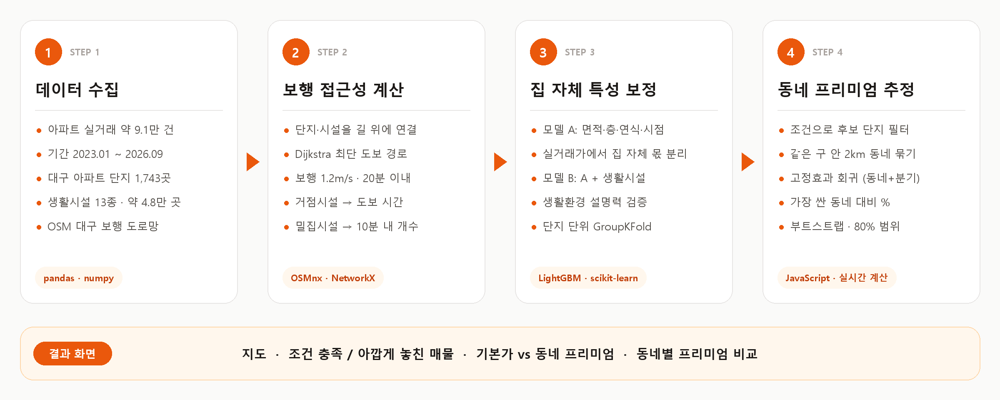

---

## 4. 서비스 화면

> 📸 모든 화면은 서비스를 실제로 조작한 시연 영상에서 캡처했습니다.

### 🙋 고객 페르소나 — 김지현 씨

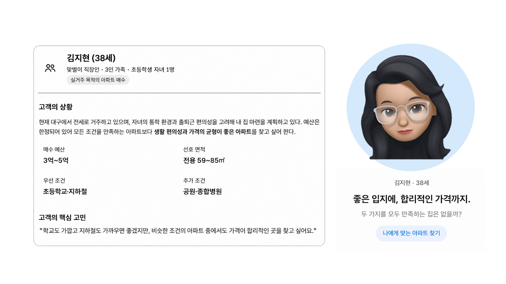

맞벌이 3인 가족, 초등학생 자녀 1명. 예산 **3억~5억**, 전용 **59~85㎡**, 우선 조건은 **초등학교·지하철**, 추가 조건은 **공원·종합병원**입니다. *"학교도 가깝고 지하철도 가까우면 좋겠지만, 비슷한 조건의 아파트 중에서도 가격이 합리적인 곳을 찾고 싶어요."*

### 🗺️ 조건 설정 → 지도 & 동네별 프리미엄

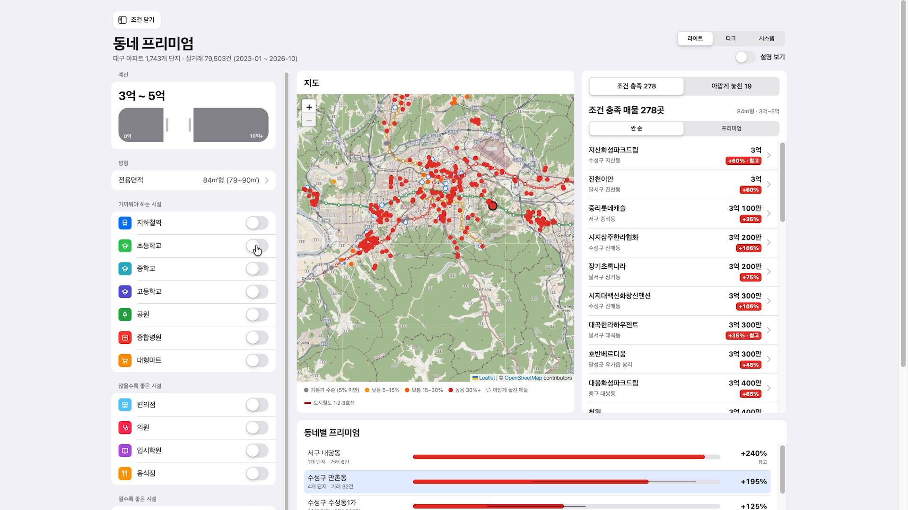

| 영역 | 기능 |
|---|---|
| **왼쪽 — 조건** | 예산 슬라이더, 평형, **가까워야 하는 시설**(지하철·초/중/고·공원·종합병원·대형마트: 5/10/15/20분), **많을수록 좋은 시설**(편의점·의원·입시학원·음식점: 도보 10분 내 개수), **멀수록 좋은 시설**(유흥주점·하수처리장) |
| **가운데 — 지도** | 조건 충족 단지를 프리미엄 수준별 색(기본가 / 낮음 5~15% / 보통 15~30% / 높음 30%+)으로 표시, 도시철도 1·2·3호선 노선 |
| **아래 — 동네별 프리미엄** | 같은 조건에서 가장 싼 동네 대비 % 막대, 동네별 단지·거래 수 |

### 🏠 단지 상세 — 기본가 vs 동네 프리미엄

<table>
  <tr>
    <td width="50%">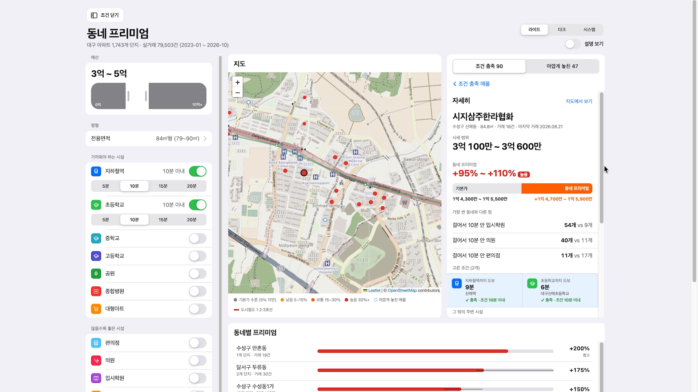</td>
    <td width="50%">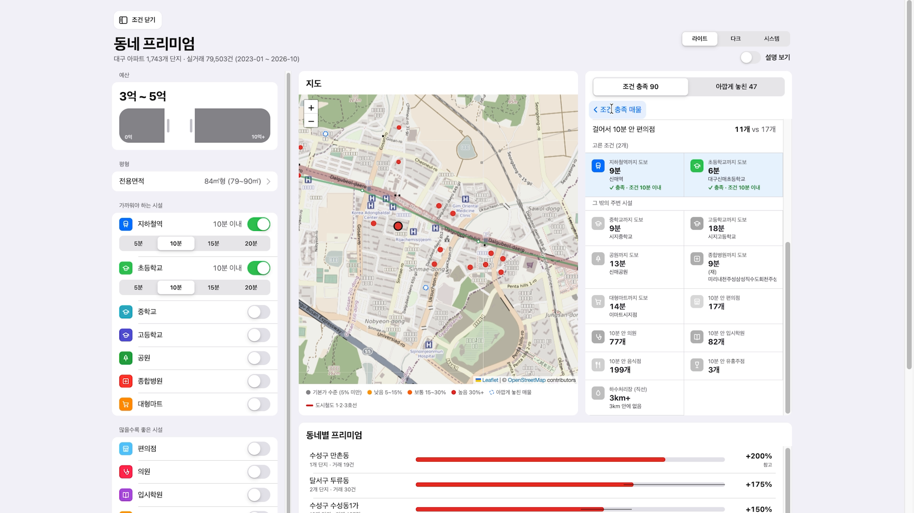</td>
  </tr>
  <tr>
    <td align="center"><b>시세 범위 · 기본가 · 동네 프리미엄</b></td>
    <td align="center"><b>고른 조건 충족 여부 · 그 밖의 주변 시설</b></td>
  </tr>
</table>

매물을 누르면 **시세 범위**(최근 1년 실거래 기준, 3건 미만이면 한 값)가 **기본가**(면적·층·연식이 같은 집이 가장 싼 동네에 있었을 때의 수준)와 **동네 프리미엄**(예: `+95% ~ +110%`)으로 나뉘어 막대로 보입니다. 즉 실제 시세 중 *동네 몫이 얼마인지*를 보여 줍니다. 그리고 **"가장 싼 동네와 다른 점"** 으로 사용자가 고르지 않은 시설까지 *걸어서 10분 안 입시학원 54개 vs 9개*처럼 비교해, 프리미엄에 무엇이 포함돼 있는지 스스로 판단할 수 있게 합니다.

### 🔍 아깝게 놓친 매물

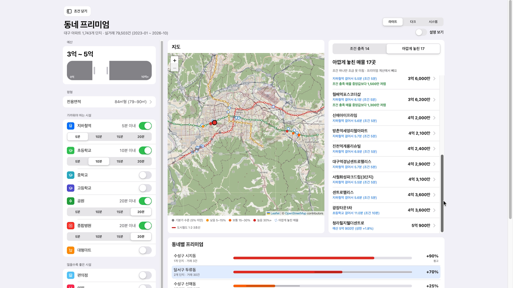

조건을 강화하면 후보가 급격히 줄어듭니다. **아깝게 놓친 매물** 탭은 *조건 하나만 조금 못 미친* 단지(예: `지하철역 걸어서 5.5분 (조건 5분)`, `예산 상한 +1.8%`)를 따로 보여 주고, **조건 충족 매물 중앙값보다 얼마나 저렴한지**를 함께 표시해 조건을 살짝 완화했을 때의 선택지를 넓혀 줍니다.

---

## 5. 핵심 기술

### 🚶 1) 실제 보행 도로망 기반 접근성 (GIS)

- OpenStreetMap 대구 **보행자 도로망**을 그래프로 불러와(OSMnx), 단지와 시설을 *가장 가까운 길 위 지점*에 연결합니다.
- 단지마다 **Dijkstra** 최단경로로 **도보 20분(보행속도 1.2m/s) 안에 닿는 모든 시설**을 기록해 `rel_단지_시설` 관계 테이블을 만듭니다.
- 지하철역은 역 중심이 아니라 **가장 가까운 출입구**까지의 거리로 계산합니다.
- 하수처리장은 냄새처럼 길과 무관하게 퍼지는 영향이므로 **직선거리 3km** 기준을 씁니다.

| 시설 구분 | 단지별 지표 |
|---|---|
| **거점 시설 7종** — 초·중·고등학교, 도시철도역, 대형마트, 종합병원, 공원 | 가장 가까운 곳까지 **도보 시간** (20분 안에 없으면 25분) |
| **밀집 시설 4종** — 편의점, 의원, 입시학원, 음식점 + 유흥주점 | 도보 10분 안 **개수** |
| **기피 시설** — 하수처리장 | 가장 가까운 곳까지 **직선거리** (3km 안에 없으면 3.5km) |

> 거점 시설은 "한 곳만 가까우면 충분"하고, 밀집 시설은 "선택지가 많을수록 좋다"는 이용 특성을 반영해 거리/개수를 나눴습니다. → [근거 자료](docs/evidence/distance_vs_count.png)

### 🧮 2) 집 자체 특성 보정 — LightGBM 모델 A·B

같은 동네에서도 넓은 집, 고층, 신축은 원래 비쌉니다. 이 차이를 그대로 두면 "신축이 많은 동네"가 "좋은 동네"로 잘못 보입니다. 그래서 실거래가에서 **집 자체 특성이 설명하는 몫을 먼저 걷어 내기 위해** LightGBM을 씁니다. 가격을 맞히는 것이 목적이 아니라, **동네 가치를 분리하기 위한 기준선**입니다.

| 구분 | 모델 A (보정 기준선) | 모델 B (검증용) |
|---|---|---|
| 입력 | 전용면적, 층, 상대층(층 ÷ 단지 최고층), 단지 최고층, 연식, 거래 시점 | 모델 A 변수 **+ 시설별 도보 시간·개수·하수처리장 거리** |
| 역할 | 집 자체 특성으로 설명되는 몫을 산출 → **실거래가 − 이 몫 = 동네가 만든 차이** | 생활환경을 넣으면 가격 차이가 더 잘 설명되는지 확인 (= 동네 가치가 실재하는지 검증) |

- 대상 값은 **log(㎡당 실거래가)** 입니다.
- **자기 단지 정보 배제** — 거래마다 보정값은 *그 단지를 뺀 채 학습한 모델*로 구합니다 (단지 단위 5겹 **GroupKFold**). 자기 단지 가격을 외워서 동네 차이까지 지워 버리는 것을 막기 위해서입니다.
- **시간 안정성 확인** — 2023~2025년 거래로 학습한 관계가 **2026년 거래**에도 유지되는지 함께 확인했습니다.

### 🏷️ 3) 동네 프리미엄 계산 (브라우저 안에서 실시간)

> **한 줄 정의:** 모델 A로 층·연식·면적·거래 시점의 영향을 빼고 남은 가격 차이를, **같은 조건의 가장 싼 동네와 비교한 %**

| 단계 | 기준 |
|---|---|
| ① 후보 | 예산·평형·시설 조건을 **모두 만족하는 단지**만 사용 |
| ② 동네 묶기 | 같은 구 안에서 **서로 2km 안**에 있는 단지끼리 묶음 (Complete Linkage 계층적 군집) |
| ③ 잔차 | 거래마다 `log(실제 ㎡당 가격) − 모델 A 보정값` = 집 자체 특성으로 설명되지 않는 몫 (고른 평형의 거래만) |
| ④ 회귀 | 단지×분기 칸으로 평균 낸 뒤 **잔차 = 동네 효과 + 분기 효과** 고정효과 회귀 (가중치 n/(n+1)) |
| ⑤ 0% 기준 | **거래 10건 이상인 동네** 중 동네 효과가 가장 낮은 곳 |
| ⑥ % 변환 | 프리미엄 = exp(동네 효과 차이) − 1 |
| ⑦ 범위 | **단지 단위 부트스트랩 60회**의 10~90% 분위 → 80% 범위 |
| ⑧ 계산 조건 | 동네 묶음이 **3개 이상**일 때만 계산 (적으면 "비교할 동네가 적다" 표시) |

<details>
<summary>📎 발표 Q&A 근거 자료 펼쳐 보기</summary>

| 질문 | 근거 |
|---|---|
| 왜 동네 반경을 2km로 잡았나요? | 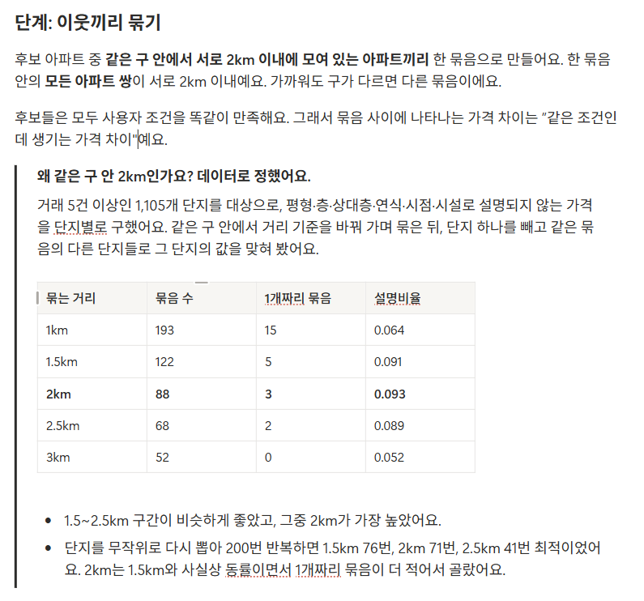 |
| 기본가(집 자체 특성 몫)는 어떻게 구하나요? | 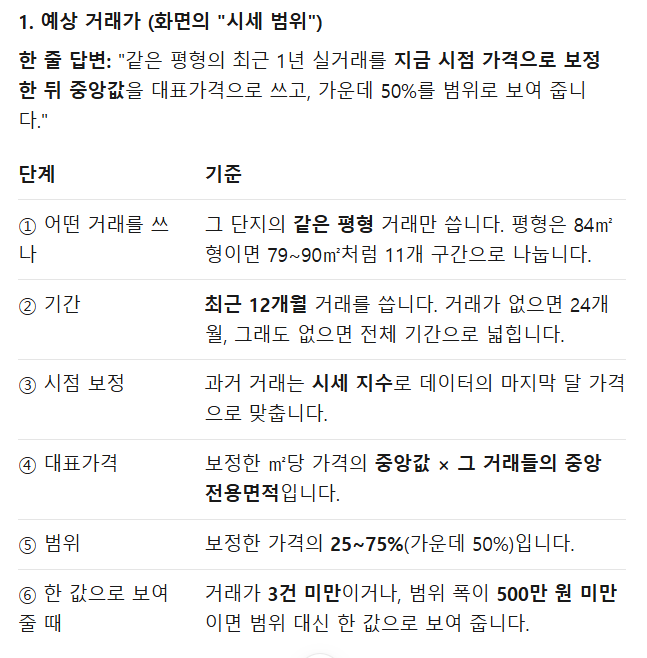 |
| 동네 프리미엄은 어떻게 계산하나요? | 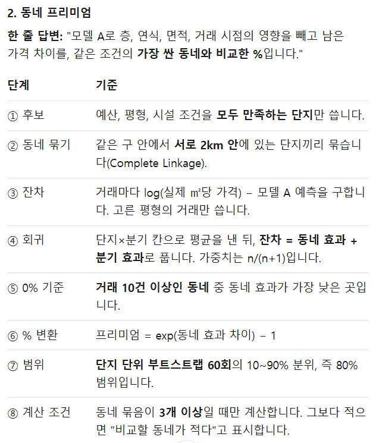 |
| 실거래가 1~2건뿐인 단지의 대표가격은 믿을 수 있나요? | 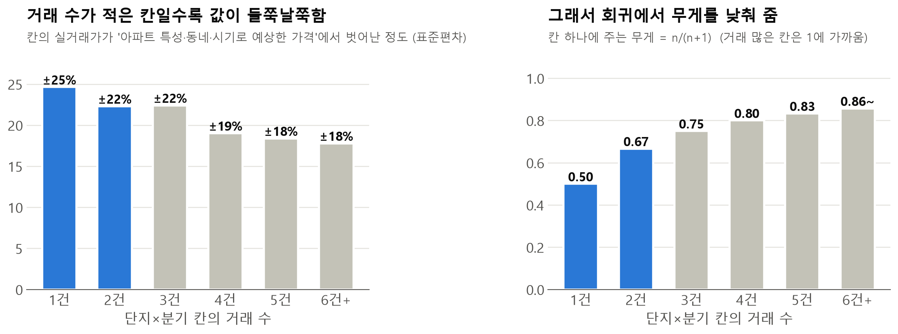 |
| 왜 어떤 시설은 거리, 어떤 시설은 개수인가요? | 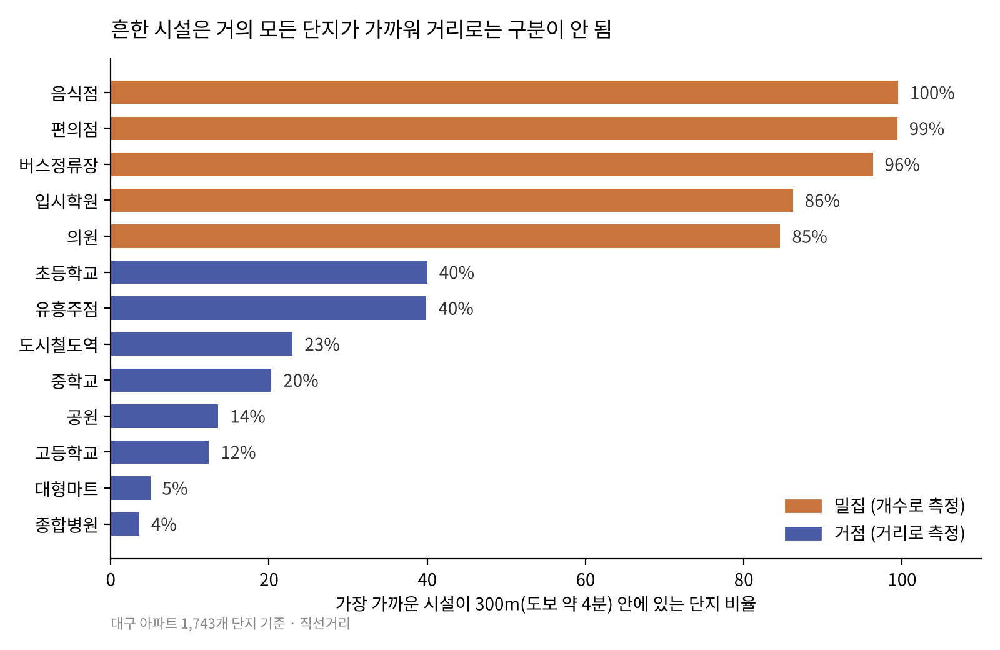 |
| 지표별 효과는 통계적으로 유의한가요? | 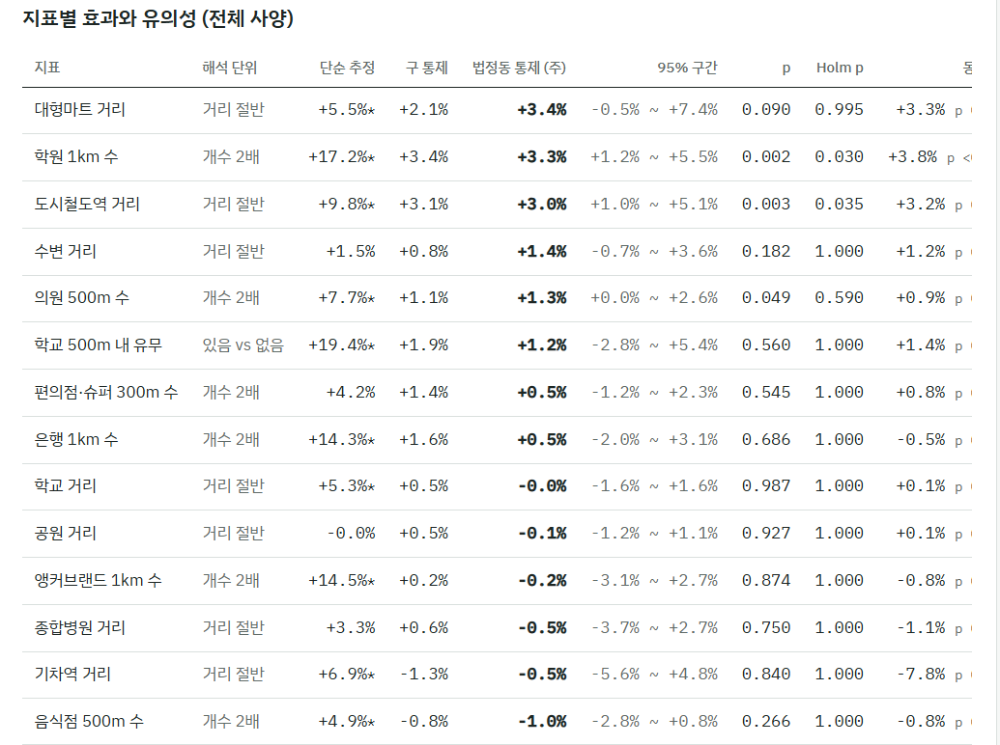 |

</details>

---

## 6. 분석 결과

### 📈 동네 가치는 실제로 존재하는가? — 설명력(R²) 비교

| 구분 | 모델 A | 모델 B |
|---|---|---|
| 입력 변수 | 아파트 자체 특성 | 아파트 자체 특성 **+ 생활시설 정보** |
| 실거래가 차이 설명력 (단지 단위 교차검증 R²) | **0.54** | **0.76** |

- 면적·층·연식·거래 시점 같은 **집 자체 특성만으로는 실거래가 차이의 약 54%** 만 설명됩니다.
- 여기에 주변 생활시설 정보를 더하면 **76%** 까지 설명됩니다. 즉, 집 자체로는 설명되지 않던 가격 차이의 상당 부분이 **동네의 생활환경과 함께 움직인다**는 뜻이고, 이것이 "동네 프리미엄"을 따로 떼어 보여 주는 근거입니다.
- 단, R² 상승만으로 *특정 시설이 가격을 올린 원인*이라고 단정할 수는 없습니다.

### 🏘️ 동네별 가격 차이

- 같은 검색 조건을 만족하는 아파트라도, 단지 특성과 거래 시점을 보정한 뒤에도 **동네에 따라 뚜렷한 가격 차이**가 남았습니다.
- 단일 수치 대신 **80% 추정 범위**를 함께 제공해 불확실성을 드러냈습니다.

### 🔎 사용자 조건 기반 검색 예시

> 예산 **3~5억**, 전용 **84㎡형**, **지하철역·초등학교 도보 10분 이내** → 조건 충족 **90곳** + 아깝게 놓친 **47곳**
> 수성구 신매동 *시지삼주한라협화*: 시세 3억 100만~3억 600만, 동네 프리미엄 **+95%~+110%** — 가장 싼 동네보다 *걸어서 10분 안 입시학원 54개 vs 9개*

---

## 7. 인사이트

1. **동네 자체의 가치가 존재한다** — 면적·층수·연식 같은 집 자체 특성만으로는 가격 차이를 다 설명할 수 없고, 주변 생활환경이 그 빈자리를 상당 부분 채웁니다.
2. **"싼 집"보다 "그 값에 무엇이 들어 있는가"** — 비슷한 면적·예산이어도 동네에 따라 가격 차이가 생깁니다. 가격과 생활환경을 함께 비교하는 것이 중요합니다.
3. **프리미엄의 가치는 사람마다 다르다** — 학원가가 중요한 가구에게 학원 밀집 동네의 프리미엄은 의미가 있지만, 이용하지 않는 가구에게는 지불할 필요가 없는 비용일 수 있습니다. 그래서 프리미엄과 함께 **실제 시설 수·접근성**을 보여 주어 사용자가 직접 판단하게 했습니다.

---

## 8. 데이터 명세

| 데이터 | 주요 항목 | 활용 목적 |
|---|---|---|
| 아파트 실거래 | 거래금액, 전용면적, 층, 거래연월일, 단지ID·단지명, 좌표, 준공연도 | 동네 가치 추정의 기초, 집 자체 특성 보정 |
| 아파트 최고층 (건축물대장) | 단지ID, 최고층 | 상대층(층 ÷ 최고층) 계산 |
| 학교 | 학교명, 유형(초·중·고), 좌표 | 교육 접근성 |
| 도시철도 | 역 중심 좌표, **역 출입구 좌표** | 교통 접근성 |
| 의료 | 종합병원(상급종합·종합), 의원 좌표 | 의료 접근성 |
| 생활편의 | 대형마트, 편의점·슈퍼, 음식점 좌표 | 생활편의성 |
| 기타 | 입시학원, 공원, 유흥주점, 하수처리장(시설용량 2만 톤/일 이상 7곳), 항공기 소음 | 주거환경 (긍정·부정 요인) |
| 보행 도로망 | OpenStreetMap 대구 walk 네트워크 | 실제 도보 시간 계산 |

**전처리**

- 거래 해제, 직거래(가족 간 거래 등 시세와 다른 가격), 유효하지 않은 금액·면적, 군위군 거래 제외
- 단지ID 기준으로 실거래와 단지 정보 연결, 단지 좌표는 해당 단지 거래 좌표의 최빈값
- 거래금액 ÷ 전용면적 → **㎡당 가격**, 분포 편차를 줄이기 위해 **로그 변환**
- 시설 좌표·중복 정제 (유흥주점은 평면좌표 → 위경도 변환)

> 📄 상세 컬럼 정의는 [`2. 데이터명세서/대구 아파트 데이터 명세서.docx`](2.%20데이터명세서) 를 참고하세요.

---

## 9. 기술 스택 & 주요 알고리즘

**Tech Stack**

- **Data / ML**: Python 3.11, pandas, numpy, scikit-learn, LightGBM
- **GIS**: OSMnx, NetworkX, OpenStreetMap
- **Front-end**: HTML · CSS · Vanilla JavaScript (브라우저 내 필터링·고정효과 회귀·부트스트랩), Leaflet

| 알고리즘 | 활용 목적 | 적용 내용 |
|---|---|---|
| **Dijkstra** | 최단 경로 탐색 | 단지 ↔ 시설 간 실제 도보 경로·시간 계산 |
| **LightGBM** | 집 자체 특성 보정 | 실거래가에서 면적·층·연식·시점 몫 분리(A), 생활시설 설명력 검증(B) |
| **GroupKFold** | 모델 검증 | 단지 단위로 학습·검증 데이터 분리 |
| **Complete Linkage** | 공간 그룹화 | 같은 구 안 아파트를 최대 2km 기준으로 동네 묶음 |
| **고정효과 회귀** | 가격 차이 분석 | 동네 효과 + 거래 분기 효과로 잔차 분해 |
| **Bootstrap** | 불확실성 추정 | 단지 단위 반복 추출로 프리미엄 80% 범위 산출 |

---

## 10. 폴더 구성 & 직접 실행하기

```
📦 dongne-premium
├─ README.md
├─ index.html                              ⭐ 서비스 페이지 (GitHub Pages가 이 파일을 링크로 띄움)
├─ docs/                                   README용 이미지·영상
│  ├─ demo/                                시연 영상 압축본(demo.mp4, 6.9MB)·썸네일
│  ├─ screenshots/                         서비스 화면 캡처
│  └─ evidence/                            발표 Q&A 근거 자료
├─ 2. 데이터명세서/
│  └─ 대구 아파트 데이터 명세서.docx       (데이터 파일은 3. 핵심코드 zip 안 입력데이터/·결과/에 포함)
├─ 3. 핵심코드/
│  ├─ 데이터전처리.zip                     ▶ 데이터전처리최종/  (단지–시설 관계 테이블 생성)
│  │   ├─ 코드/build_relations.py
│  │   ├─ 입력데이터/                      실거래 좌표, 시설 좌표 13종, 도로망/daegu_walk.graphml
│  │   └─ 결과/                            rel_단지_시설.csv, dim_단지.csv, dim_시설.csv, fac_권역_요약.csv
│  └─ BACK_AND_UI.zip                      ▶ 진짜_최종_UI/  (모델 학습 + HTML 생성)
│      ├─ 코드/UI생성코드_최종.py
│      ├─ 입력데이터/                      daegu_apt_trades.csv, dim_단지.csv, rel_단지_시설.csv, 최고층, 도시철도역좌표
│      └─ 결과/동네프리미엄_최종.html
├─ 5. 결과보고서/iM뱅크 결과보고서.docx
└─ 6. 발표자료/
   ├─ 동네프리미엄_최종_다운로드후실행필요.html   (index.html과 같은 파일)
   ├─ 맨땅에헤딩_PPT 발표_Final.pdf / .pptx
   └─ 기타 근거자료/
```

### Step 1. 단지–시설 관계 테이블 만들기

```powershell
pip install pandas numpy scikit-learn networkx osmnx openpyxl
cd 데이터전처리최종/코드
python build_relations.py
```

- 몇 분 걸립니다. 화면에 `walk 도로망: 캐시 사용`이 나오면 저장된 도로망을 그대로 쓰는 것입니다. (없으면 OSM에서 받아 `입력데이터/도로망/`에 저장)
- 분석 기간은 `build_relations.py`의 `LAST_YM = 202609`로 정합니다.
- 결과 `결과/dim_단지.csv`, `결과/rel_단지_시설.csv`를 `진짜_최종_UI/입력데이터/`에 같은 이름으로 복사합니다.

```python
# 활용 예: 단지별 도보 10분 안 입시학원 수, 가장 가까운 초등학교
rel = pd.read_csv("결과/rel_단지_시설.csv", encoding="utf-8-sig")
학원10분 = rel[(rel.시설유형 == "입시학원") & (rel.도보_분 <= 10)].groupby("complex_id").size()
최근접초등 = rel[(rel.시설유형 == "초등학교") & (rel.순위 == 1)]
```

### Step 2. 모델 학습 + HTML 생성

```powershell
pip install pandas numpy scikit-learn lightgbm
cd 진짜_최종_UI/코드
python UI생성코드_최종.py            # --no-serve 를 붙이면 localhost 자동 실행을 끕니다
```

- 모델 A·B를 학습하고 검증 점수(교차검증 R², 2026년 거래 R²)를 출력한 뒤 `결과/동네프리미엄_최종.html`을 만들어 localhost로 엽니다.
- 데이터를 바꿀 때는 `입력데이터/`의 파일을 같은 이름으로 교체하고 다시 실행합니다.
- 새로 만든 HTML을 저장소 루트의 `index.html`로 덮어써서 올리면 서비스 링크에도 바로 반영됩니다.

---

## 11. 참고 자료

- 국토교통부, **「2024년도 주거실태조사 통계보고서」** — 주거 이동 사유 (전국 vs 대구)
- 국토연구원, **「기초생활인프라(생활SOC) 국가적 최저기준」** — 보행 일상권(도보 10~15분) 필수 생활인프라 기준 · [국토연구원 브리프](https://www.krihs.re.kr/galleryDownload.es?bid=0024&list_no=27785&seq=1)
- 통계청 SGIS, **「살고싶은 우리동네」 주거지 평가 지표** — [지표 정의](https://sgis.mods.go.kr/view/newhelp/house_help_10_0) · [서비스 지도](https://sgis.kostat.go.kr/view/house/houseAnalysisMap)
- 이소영·김명연·김은정 (2020), **「아파트 가격에 영향을 미치는 근린환경 요인 분석」**, 계명대학교 도시계획 및 교통공학과 — 대구 수성구 아파트 가격은 고교 거리·사설학원 수·지하철역 거리·공공체육시설 수 등과 유의한 상관 · [RISS](https://www.riss.kr/link?id=A106847975)
- 국토연구원, **「국토이슈리포트」 2호**

---

## 12. 팀 소개

**팀 맨땅에헤딩** · 진행 기간 2026.10.29 – 2026.11.10

| 이름 | 역할 |
|---|---|
| 이현도 (팀장) | 프로젝트 총괄 및 결과 검증 |
| 김선주 | 데이터 수집 및 전처리, UI 개선 |
| 배채정 | EDA 및 입지조건 분석 |
| 전은환 | 입지 가치 학습 모델 개발, 모델 신뢰성 검토 |
| 장재열 | 맞춤형 순위 추천 서비스 구현, PPT·일일일지 등 문서 작성 |


---

<div align="center">

**Team 맨땅에헤딩** — [iM뱅크] iM Digital Banker Academy 데이터 분석 전문가 양성 과정 최종 프로젝트

<sub>본 서비스의 동네 프리미엄은 통계 모델로 추정한 상대적 가격 차이이며, 투자 권유나 가격 보증이 아닙니다.</sub>

</div>
